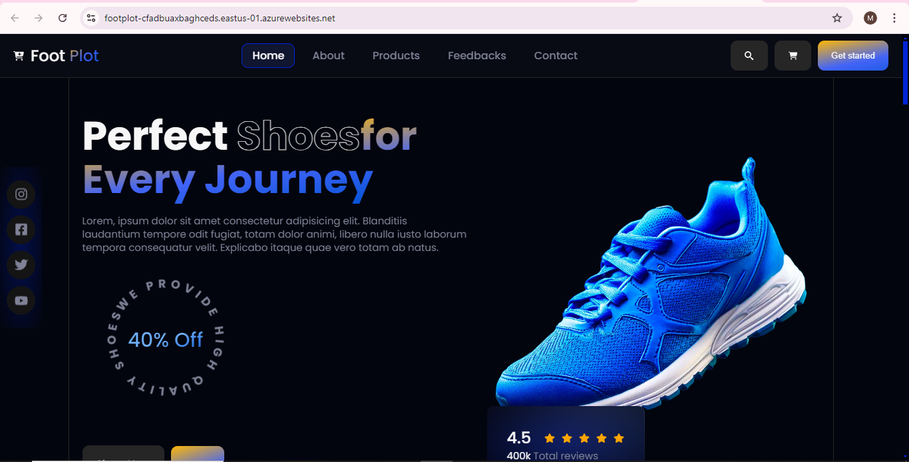
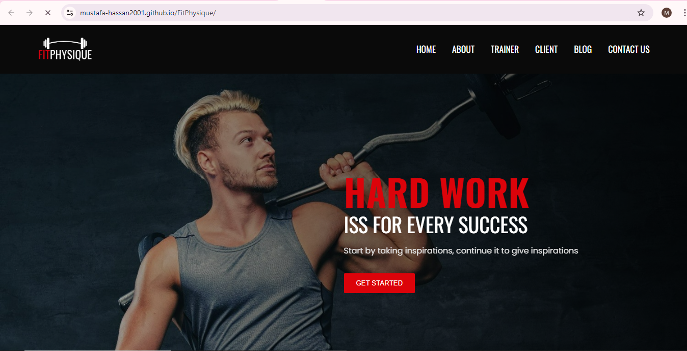
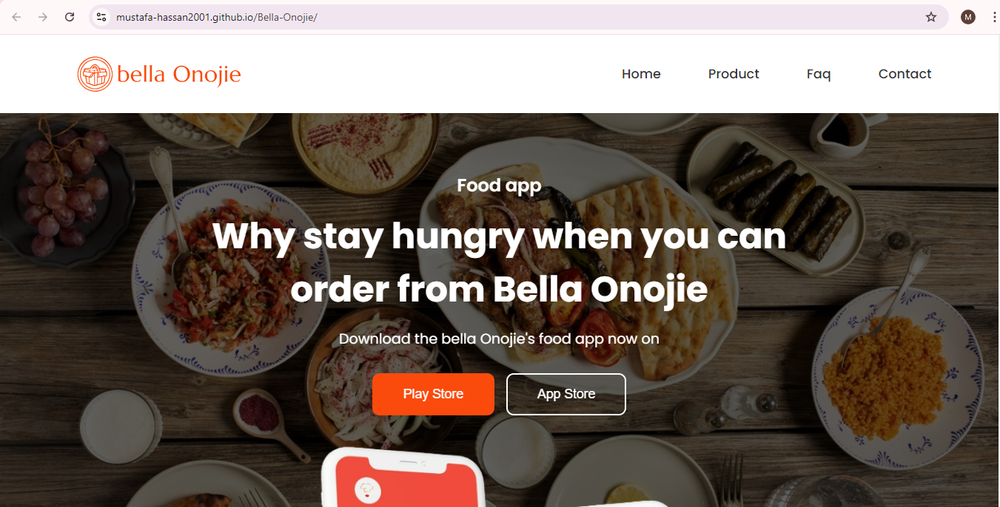
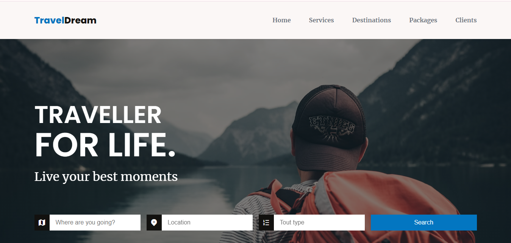
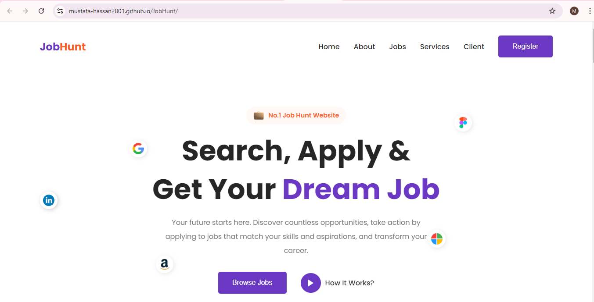
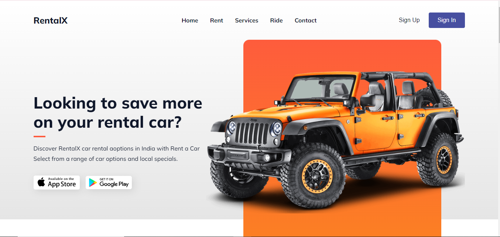
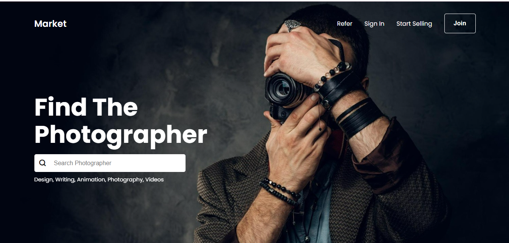
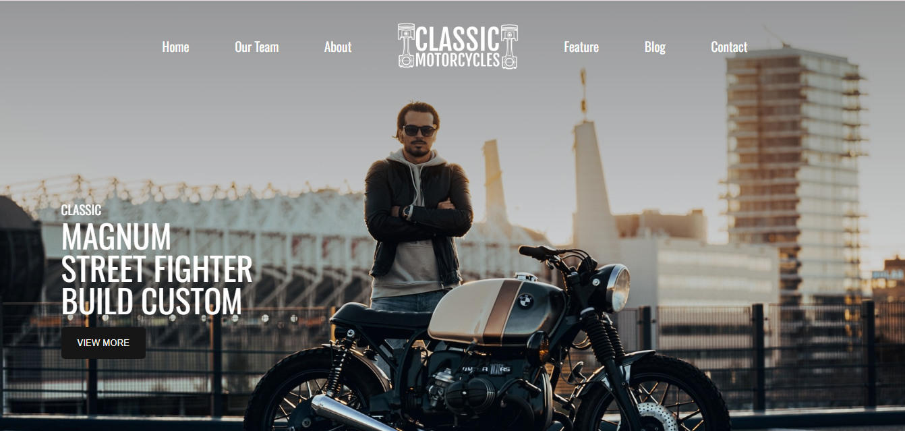

    
    &nbsp;
    

    

  

 
<h2 align="center">🔐 Securing Systems. Hardening Networks. Building Softwares. 🔐</h2>

Cybersecurity analyst and MERN stack developer — breaking things to understand them, then building them better. Passionate about web security, network defense, and competitive programming. On a mission to engineer systems that are as resilient as they are functional.

 

<h2 align="center">⚒️ Languages-Frameworks-Tools ⚒️</h2>
 

    
     

<h2 align="center">🏆 Profile Trophies 🏆</h2>
 

  

&nbsp;

<h1 align="center">Projects: "LEARN, BUILD & REPEAT" 💻</h1>

I believe in implementing the knowledge which you have. Projects play a major role in showcasing your skills. They help in predicting skills of a person. So let's have a look at my project section.

  
<!-- <h1 align="center">Projects</h1> -->
<table bordercolor="#66b2b2">

<tr>
  <td width="50%" valign="top">
      <h3 align="center">FootPlot</h3>
         
        
         
        

           
   
    
      

        
<strong>FootPlot: Animated E-commerce Website in React</strong> - FootPlot is a visually captivating e-commerce platform built with React, offering smooth animations for an immersive shopping experience. It features detailed product listings, responsive design, secure checkout, real-time updates on stock. Discover the latest in footwear with FootPlot.

    </td>
    <td width="50%" valign="top">
      <h3 align="center">Fitphysique</h3>
         
      
         
        

    
  
         
      

        
<strong>HTML5, CSS3 & Javascript</strong> - Fitphysique : This is user-friendly website where you can see details about gym, trainers, facility, class schedule and monthly packages.

    </td>
  </tr>
  
  <tr>
    <td width="50%" valign="top">
      <h3 align="center">Bella Onojie</h3>
         
        
         
        

           
    
  
      

        
<strong>Html, CSS, BootStrap & Javascript</strong> - Bella Onojie :  A restaurant website. You can place orders and keep track of it.

    </td>
    <td width="50%" valign="top">
      <h3 align="center">TravelDream</h3>
         
      
         
        

    
  
  
      

        
<strong>Html, CSS & Javascript</strong> - TravelDream : A tourist guide.

    </td>
  </tr>
  
  <tr>
    <td width="50%" valign="top">
      <h3 align="center">JobHunt</h3>
       
        
       
        

           
  
  
      

        
<strong>HTML5, CSS3, & Javascript</strong> - JobHunt : I created a responsive website called “JobHunt” where users can browse job listings, view detailed job descriptions, and apply for positions.

    </td>
<td width="50%" valign="top">
      <h3 align="center">RentalX</h3>
         
        
         
        

           
  
  
      

        
<strong>HTML5, CSS3 & Javascript</strong> - RentalX : This is user-friendly website where you can browse various cars for rent. You can easily select and book a car for your rental needs.

    </td>
  </tr>

   <tr>
    <td width="50%" valign="top">
      <h3 align="center">MarKet</h3>
       
        
       
        

           
  
  
      

        
<strong>HTML5, CSS3, Bootstrap & Javascript</strong> - I created a responsive photography portfolio website called “Market” where you can showcase various photography projects. Visitors can explore the portfolio and contact the photographer.

    </td>
   <td width="50%" valign="top">
      <h3 align="center">Classic Motorcycle</h3>
       
        
       
        

           
  
  
      

        
<strong>HTML5, CSS3, & Javascript</strong> - Classic Motorcycle is a responsive website  for showcasing various BMW bikes. Visitors can explore different models and features, and place an order.

    </td>
  </tr>   
</table>

# 🏆 HacktoberFest 2024 Badges
 

 
